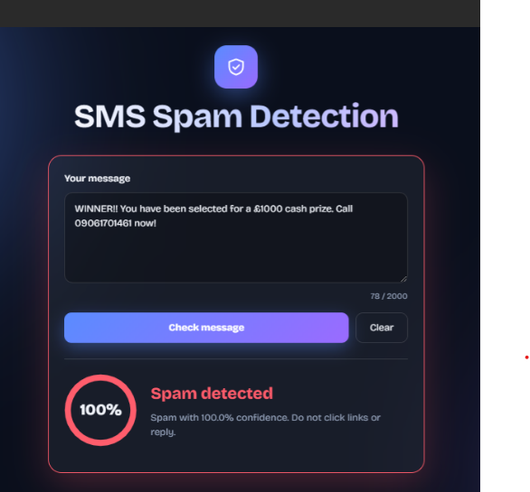
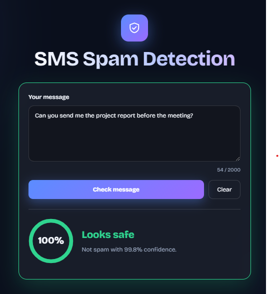

# SMS Spam Detector

End-to-end text classification project: **TF-IDF + Logistic Regression / Naive Bayes** trained on the SMS Spam Collection dataset (Kaggle), served through a **Flask** API with a clean web UI.

## Project structure
```
sms-spam-detector/
├── datasets/      # spam.csv (download from Kaggle)
├── notebook/      # spam_detector.ipynb  (EDA, training, evaluation)
├── backend/       # app.py (Flask API) + spam_model.joblib (created by notebook)
├── frontend/      # index.html + style.css
└── requirements.txt
```

## Dataset
Download **SMS Spam Collection Dataset** from Kaggle (`uciml/sms-spam-collection-dataset`) and place `spam.csv` inside the `datasets/` folder.

## Run it
```bash
pip install -r requirements.txt
cd notebook && jupyter notebook spam_detector.ipynb   # Run All -> saves backend/spam_model.joblib
cd ../backend && python app.py                         # open http://127.0.0.1:5000
```

## What this project covers
- Cleaning text and vectorizing with `TfidfVectorizer` (unigrams + bigrams)
- Baseline ("always not-spam") vs. MultinomialNB vs. LogisticRegression
- Honest evaluation: stratified split, confusion matrix, precision / recall / F1
- Model interpretation (top spam / ham words) and testing on custom messages
- Deployment as a REST API (`POST /predict`) with a web frontend

## API
`POST /predict` with `{"message": "..."}` returns `{"label": "spam", "spam_probability": 0.98}`.

## Results
Add your final numbers here after running the notebook (accuracy, spam precision, spam recall, F1).



